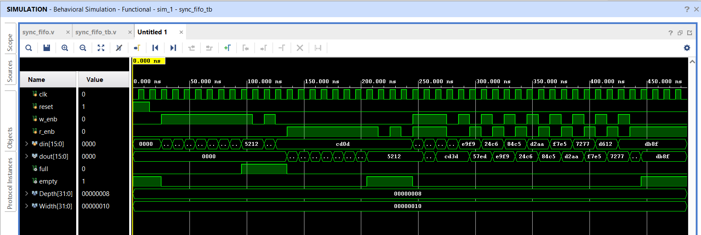

# Synchronous FIFO — Design & Verification (Verilog & UVM)

A parameterizable **Synchronous FIFO** (First-In, First-Out) buffer implemented in Verilog, verified using both a directed Verilog testbench and a complete **SystemVerilog UVM 1.2** verification environment.

---

## 📐 FIFO Architecture

```
            ┌─────────────────────────────────┐
   din ────►│                                 │────► dout
  w_enb ───►│       FIFO Memory Array         │
  r_enb ───►│     (Depth × Width bits)        │
            │                                 │
   clk ────►│   wptr ──►  [ ][ ][ ]...        │────► full
 reset ────►│   rptr ──►  count tracker       │────► empty
            └─────────────────────────────────┘
```

| Signal | Direction | Width | Description |
|--------|-----------|-------|-------------|
| `clk` | Input | 1 | System clock |
| `reset` | Input | 1 | Asynchronous active-high reset |
| `w_enb` | Input | 1 | Write enable |
| `r_enb` | Input | 1 | Read enable |
| `din` | Input | `Width` | Data input |
| `dout` | Output | `Width` | Data output |
| `full` | Output | 1 | High when FIFO is full |
| `empty` | Output | 1 | High when FIFO is empty |

### Design Highlights
- **Parameterizable** depth (default 8) and data width (default 16-bit).
- **Circular buffer** using modular pointer indexing (`wptr`, `rptr`).
- **Internal counter** (`count`) for clean flag generation.
- **Overflow & underflow protection** against illegal read/write operations.
- **Simultaneous Read & Write** supported without losing data integrity.

---

## 📁 Repository Structure

```
.
├── sync_fifo.v              # RTL design of synchronous FIFO
├── sync_fifo_tb.v           # Directed Verilog testbench
├── sync_fifo_uvm_tb.sv      # SystemVerilog UVM 1.2 testbench (single-file architecture)
├── sync_fifo_monitor_verilog.txt  # Directed simulation transcript ($monitor output)
├── waveform.png             # Simulation waveform screenshot (Vivado)
└── README.md                # Documentation
```

---

## 🏗️ UVM Verification Architecture

The UVM testbench (`sync_fifo_uvm_tb.sv`) follows the standard Universal Verification Methodology:

```
┌────────────────────────────────────────────────────────┐
│                   fifo_base_test                       │
│  ┌──────────────────────────────────────────────────┐  │
│  │                     fifo_env                     │  │
│  │  ┌───────────────────────┐   ┌────────────────┐  │  │
│  │  │      fifo_agent       │   │fifo_scoreboard │  │  │
│  │  │  ┌─────────────────┐  │   │ (queue-based   │  │  │
│  │  │  │  sequencer      │  │   │  golden model) │  │  │
│  │  │  │  ↓ (seq_item)   │  │   │                │  │  │
│  │  │  │  driver ───────────────┼─► DUT          │  │  │
│  │  │  │                 │  │   │    │           │  │  │
│  │  │  └─────────────────┘  │   │    ▼           │  │  │
│  │  │     monitor ──────────────┼──► analysis_imp│  │  │
│  │  └───────────────────────┘   └────────────────┘  │  │
│  └──────────────────────────────────────────────────┘  │
└─────────────────────────┬──────────────────────────────┘
                          │
                   fifo_if (virtual)
```

### Components
1. **`fifo_if`**: Bundles interface signals connecting testbench to the DUT.
2. **`fifo_seq_item`**: Sequence item defining randomized stimulus (`w_enb`, `r_enb`, `din`).
3. **`fifo_base_sequence`**: Orchestrates stimulus scenarios (FIFO fill, overflow, drain, underflow, concurrent R/W).
4. **`fifo_sequencer`**: Buffers and delivers sequence items to the driver.
5. **`fifo_driver`**: Translates sequence items into pin-level activity on `negedge clk` to maintain clean setup time.
6. **`fifo_monitor`**: Samples interface signals after clock edges and publishes them via `uvm_analysis_port`.
7. **`fifo_scoreboard`**: Compares sampled DUT outputs and flags against an internal golden reference model (`ref_fifo[$]`).
8. **`fifo_agent` & `fifo_env`**: Encapsulates components into a standard modular testbench hierarchy.
9. **`tb_top`**: Top-level simulation module generating clock, reset, and invoking `run_test()`.

---

## 🧪 Simulation Results

### 1. Directed Simulation Waveform (Vivado)


### 2. UVM Simulation Report (Vivado XSim)
```text
--- UVM Report Summary ---

** Report counts by severity
UVM_INFO :    5
UVM_WARNING :    0
UVM_ERROR :    0
UVM_FATAL :    0
** Report counts by id
[RNTST]     1
[TEST_DONE]     1
[UVM/COMP/NAMECHECK]     1
[UVM/RELNOTES]     1
[fifo_scoreboard]     1
```

---

## 🚀 How to Run in Xilinx Vivado

### Running the UVM Testbench:
1. Open Vivado and add `sync_fifo.v` as a **Design Source**.
2. Add `sync_fifo_uvm_tb.sv` as a **Simulation Source** (ensure file type is set to **SystemVerilog**).
3. Open **Simulation Settings**:
   - In **Compilation** tab (`xvlog.more_options`), add: `-L uvm`
   - In **Elaboration** tab (`xelab.more_options`), add: `-L uvm`
4. Set `tb_top` as top module under simulation sources.
5. Click **Run Behavioral Simulation**.
